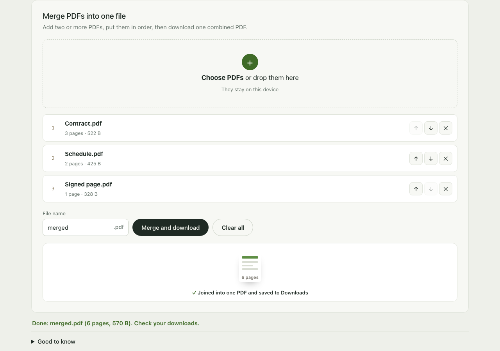
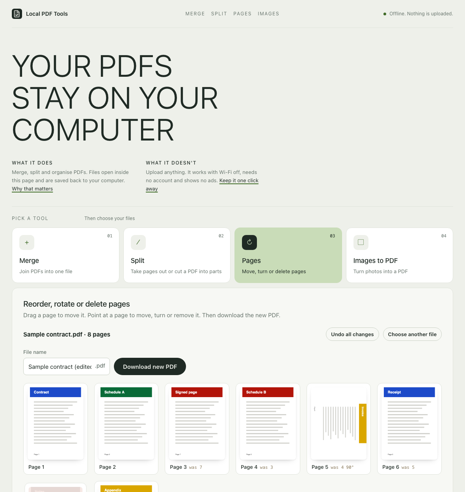

# Local PDF Tools

**Merge, split and organise PDFs on your own computer. Nothing is uploaded.**

Free PDF websites ask you to upload your files, which can include contracts, IDs or bank statements. Local PDF Tools does the same jobs without your files ever leaving your computer. It even works with Wi-Fi turned off.

### [⬇ Download Local PDF Tools (free)](https://github.com/Aamir1873/local-pdf-tools/releases/latest/download/Local-PDF-Tools-v1.0.zip)

<picture>
  <source media="(prefers-color-scheme: dark)" srcset="docs/screenshots/tool-dark.png">
  
</picture>

## How to use it

1. **Download** the file above and open it. On a Mac, double-click it to unzip. On Windows, right-click it and choose **Extract All**.
2. **Double-click** `Local PDF Tools.html`. It opens in your web browser (Chrome, Edge, Firefox or Safari).
3. **Pick a tool**, choose your files, and the new PDF is saved to your Downloads folder.

There's nothing to install and no account to make.

## What it can do

- **Merge**: join several PDFs into one, in the order you choose.
- **Split**: keep only the pages you need, save every page as its own PDF, or cut a PDF into equal or custom parts.
- **Pages**: drag pages into a new order, turn them or remove them, with a preview of each page. Each page shows where it was before, so you can see your changes.
- **Images to PDF**: turn photos or scans into a PDF, one page per image.

After each job, a short animation shows what happened: the files joining into one, a PDF splitting into parts, or the pages moving into their new order. It follows your computer's light or dark setting, and the animations switch off if you've turned motion off.

<picture>
  <source media="(prefers-color-scheme: dark)" srcset="docs/screenshots/merge-dark.png">
  
</picture>



The download also has a short guide (PDF) on doing the same with the tools already on your Mac, Windows PC, iPhone, iPad, Android phone, Chromebook or Linux computer.

## Keep it one click away

- Move `Local PDF Tools.html` from Downloads to your Documents folder first.
- **Mac**: drag it to the Dock, next to the Trash.
- **Windows**: right-click it, then **Show more options › Send to › Desktop (create shortcut)**.
- **Any computer**: open it and press **Ctrl + D** (**Command + D** on a Mac) to bookmark it.

## Questions or problems

[Open an issue](https://github.com/Aamir1873/local-pdf-tools/issues) and describe what happened.

---

## For developers

The whole tool is one HTML file with [pdf-lib](https://github.com/Hopding/pdf-lib) and [PDF.js](https://github.com/mozilla/pdf.js) built in. A Content Security Policy (`connect-src 'none'`) blocks every network request.

### Build from source

Requires Node.js 22+ and Google Chrome.

```bash
npm install
npm run build     # builds release/files/Local PDF Tools.html
npm test          # 41 end-to-end tests in headless Chrome
npm run release   # build, print the guide to PDF, take screenshots, zip
```

Set `CHROME` if Chrome isn't at the default macOS path.

### How it works

`src/build.mjs` inlines [pdf-lib](https://github.com/Hopding/pdf-lib) and [PDF.js](https://github.com/mozilla/pdf.js) into one HTML file with the app (`src/app`) and the guide (`src/content`). The tests (`src/test/run.mjs`) open the built file from disk in headless Chrome through the DevTools protocol (`lib/cdp.mjs`), use every tool, and check each download with pdf-lib and `unzip -t`. See [the test report](src/test/TEST-REPORT.md).

```
src/app/        the page: template, styles, UI (app.js) and PDF logic (core.js)
src/content/    the built-in guide
src/guide/      the printable guide
src/test/       end-to-end tests, fixtures and the latest report
lib/            headless Chrome helpers for tests and screenshots
```

## Licence

Free to use and to share unchanged, but not for resale. See [LICENSE](LICENSE). pdf-lib is MIT licensed and PDF.js is Apache 2.0.
