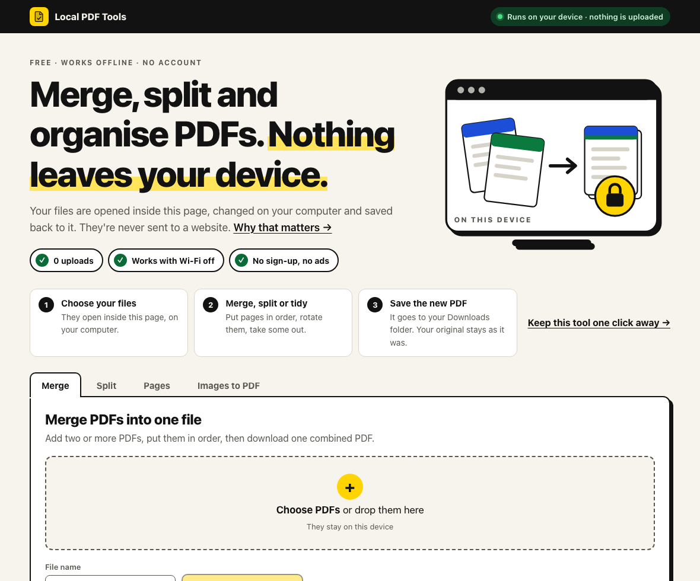

# Local PDF Tools

Merge, split and organise PDFs in your browser, without uploading them anywhere.

Local PDF Tools is a single HTML file. Open it from disk and it works offline in Chrome, Edge, Firefox or Safari. A Content Security Policy (`connect-src 'none'`) blocks every network request, so your files never leave your computer.



## Features

- **Merge**: combine PDFs in the order you choose.
- **Split**: keep selected pages, export every page, split every N pages, or define your own parts (downloaded as a ZIP).
- **Pages**: reorder, rotate and delete pages with live previews.
- **Images to PDF**: turn photos and scans into a PDF, with EXIF rotation, page size and margins.
- **Guide**: how to merge and split PDFs with the tools already built into macOS, Windows, iOS, Android, ChromeOS and Linux.


## Download

Get `Local-PDF-Tools-v1.0.zip` from [Releases](../../releases), unzip it and double-click `Local PDF Tools.html`.

## Build from source

Requires Node.js 22+ and Google Chrome.

```bash
npm install
npm run build     # builds release/files/Local PDF Tools.html
npm test          # 41 end-to-end tests in headless Chrome
npm run release   # build, print the guide to PDF, take screenshots, zip
```

Set `CHROME` if Chrome isn't at the default macOS path.

## How it works

`src/build.mjs` inlines [pdf-lib](https://github.com/Hopding/pdf-lib) and [PDF.js](https://github.com/mozilla/pdf.js) into one HTML file with the app (`src/app`) and the guide (`src/content`). The tests (`src/test/run.mjs`) open the built file from disk in headless Chrome through the DevTools protocol (`lib/cdp.mjs`), use every tool, and check each download with pdf-lib and `unzip -t`. See [the test report](src/test/TEST-REPORT.md).

```
src/app/        the page: template, styles, UI (app.js) and PDF logic (core.js)
src/content/    the built-in guide
src/guide/      the printable guide
src/test/       end-to-end tests, fixtures and the latest report
lib/            headless Chrome helpers for tests and screenshots
```

## Licence

Free to use and to share unchanged, but not for resale. See [LICENSE](LICENSE). pdf-lib is MIT licensed and PDF.js is Apache 2.0.
